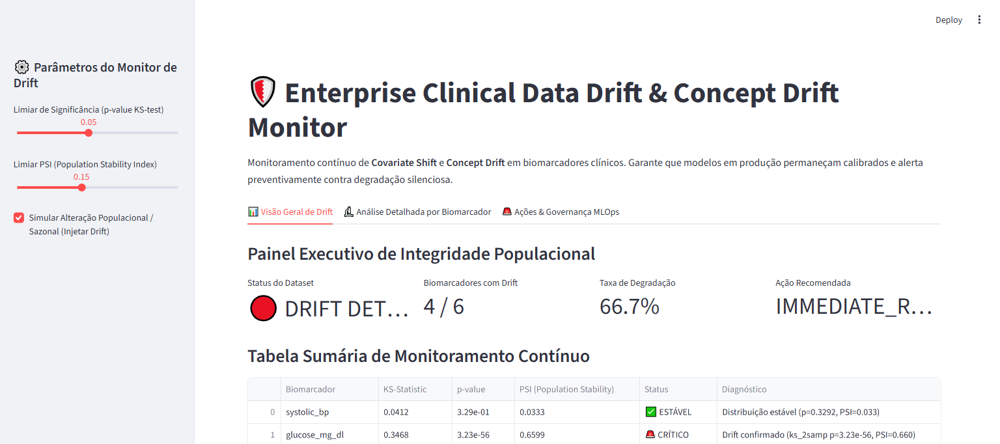
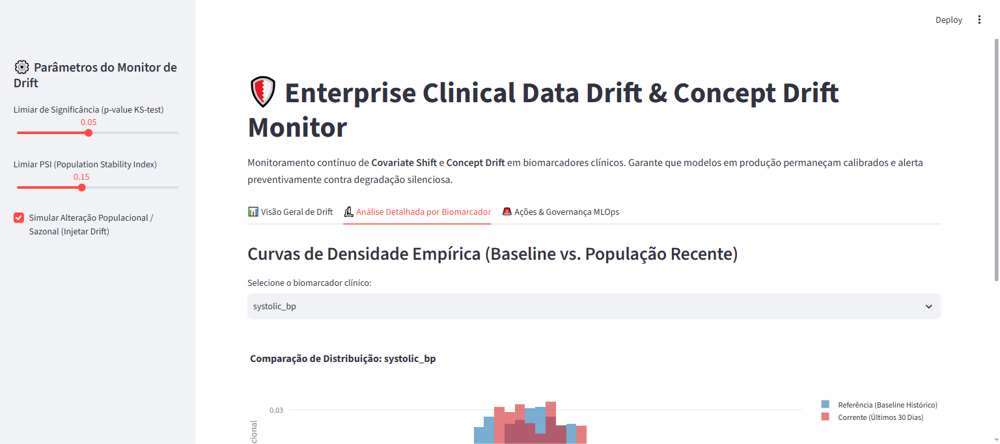

# 🛡️ Enterprise Clinical Data Drift & Concept Drift Monitor

[](https://www.python.org/downloads/)
[](#)
[](https://streamlit.io/)
[](#)
[](#)
[](#)

Sistema de monitoramento contínuo de **Covariate Shift** e **Concept Drift** para dados clínicos e biomarcadores laboratoriais hospitalares.

---

## 📸 Validação Visual de Execução (Playwright E2E)

### 1. Painel Geral de Deriva Populacional e Integridade Estatística


### 2. Comparação de Curvas de Densidade Empírica (Baseline vs. População Recente)


---

## 🎯 Por que o Monitoramento de Drift é Vital em Saúde?

Em hospitais e redes de saúde suplementar, a precisão preditiva de algoritmos (como triagem de sepse ou risco de reintubação) degrada silenciosamente ao longo do tempo por múltiplos fatores:
- **Sazonalidade e Demografia**: aumento de internações geriátricas no inverno.
- **Variação de Métodos Laboratoriais**: alteração de reagentes ou calibrações de analisadores bioquímicos (creatinina, PCR, eletrólitos).
- **Mutações Epidemiológicas**: novos fenótipos clínicos ou perfis de resposta inflamatória.

Este motor calcula em tempo real o teste bicaudal de **Kolmogorov-Smirnov (KS-test)** e o índice de estabilidade populacional (**Population Stability Index - PSI**) para emitir alertas e disparar gatilhos automáticos de re-treinamento antes que o paciente seja exposto a um modelo dessensibilizado.

---

## 🏛️ Estrutura Arquitetural (CRISP-DM + SDD)

```
data-drift-detector-evidently/
├── SPEC.md                           # Contratos Pydantic de entrada e saída
├── crisp_dm/
│   └── 01_business_understanding.md  # Formalização de negócio e critérios regulatórios
├── src/
│   ├── schemas.py                    # Schemas estruturados e validação de tipos
│   ├── detector.py                   # Motores estatísticos (KS, PSI, Wasserstein)
│   └── app.py                        # Interface analítica e gerador de relatórios
├── tests/
│   └── unit/
│       └── test_detector.py          # Bateria de testes de sanidade com PyTest
├── docs/
│   └── screenshots/                  # Provas de execução via Playwright
├── Dockerfile                        # Implantação segura em container
└── requirements.txt                  # Dependências fixadas
```

---

## 🧪 Métricas Estatísticas Empregadas

| Teste Estatístico | Limiar Operacional | Finalidade Clínica |
| :--- | :--- | :--- |
| **Kolmogorov-Smirnov (KS)** | $p < 0.05$ | Detecta deslocamento não-paramétrico na função cumulativa empírica. |
| **Population Stability Index (PSI)** | $PSI > 0.15$ | Quantifica a magnitude da divergência populacional em decis. |
| **Taxa Global de Drift** | $> 33\%$ das features | Dispara recomendação de re-treinamento com novos dados e auditoria médica. |

---

## 🚀 Como Executar Localmente

### 1. Clonar o repositório
```bash
git clone https://github.com/generozo-paulo/data-drift-detector-evidently.git
cd data-drift-detector-evidently
```

### 2. Instalar dependências
```bash
pip install -r requirements.txt
```

### 3. Executar testes de unidade
```bash
python -m pytest tests/unit/ -v
```

### 4. Executar Dashboard Interativo
```bash
python -m streamlit run src/app.py
```
Acesse em: `http://localhost:8501`

---

## 🐳 Execução via Docker

```bash
docker build -t clinical-data-drift-monitor .
docker run -p 8501:8501 clinical-data-drift-monitor
```

---

## 👨‍💻 Autor

**Paulo Generozo**
- GitHub: [@generozo-paulo](https://github.com/generozo-paulo)
- Especialização: Machine Learning & Arquitetura de MLOps em Saúde
